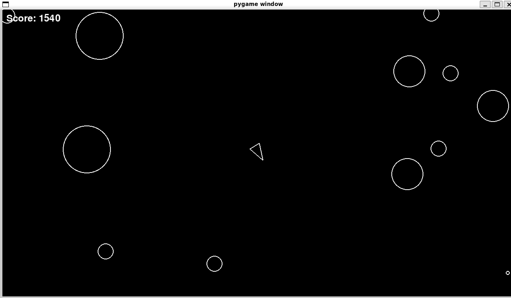

# Asteroids

A recreation of the classic arcade game Asteroids, built using Python using Pygame as part of my Boot.dev learning journey.



## About the Project

In this project I built a playable version of Asteroids where the player controls the spaceship, shoots at incoming asteroids and tried to survive as long as possible.


## Built With
 
* Python
* Pygame

## Features

* Player movement and rotation
* Projectile shooting
* Asteroid spawning and movement
* Collision detection
* Score tracking

## What I've Learnt

This project has given me the opportunity to practice object-oriented programming in Python and helping reinforce the ideas around how classes work with each other.
I also added a scoring system as an extra feature.

## Getting Started

### Prerequisites

* Python
* Pygame

### Installation

* Clone the repository
* Install the dependencies
* Run the game

```
uv run main.py
```